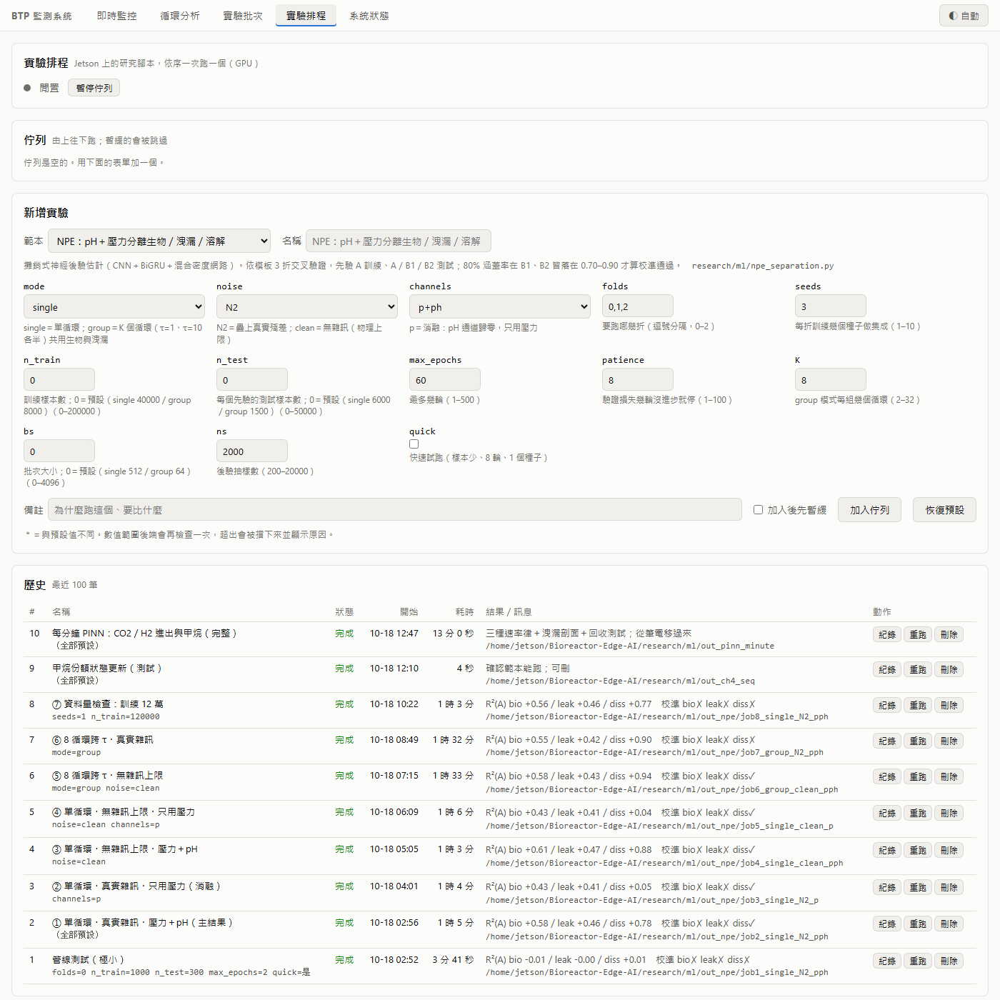
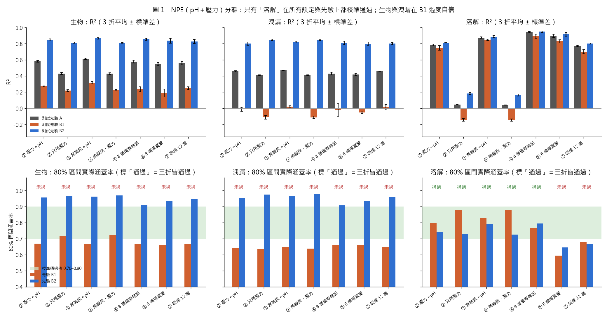
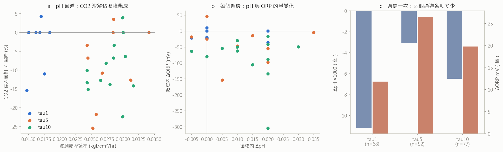
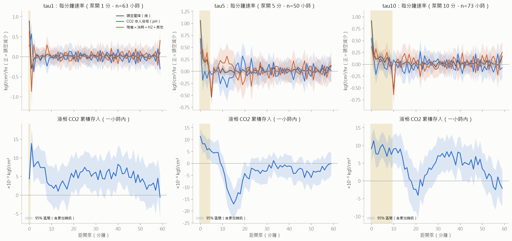
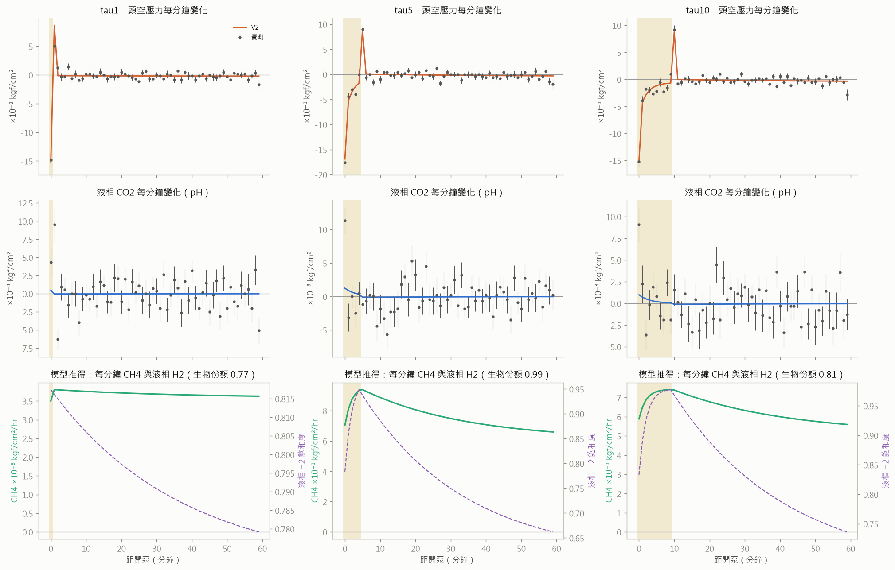
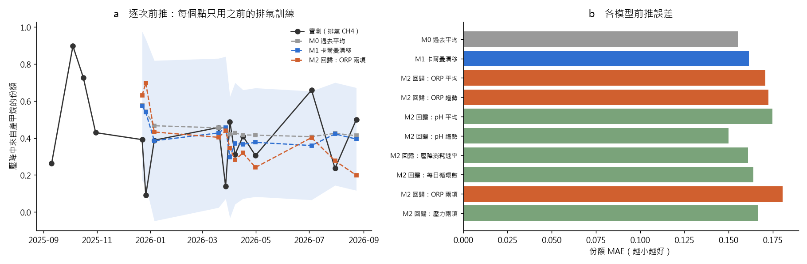
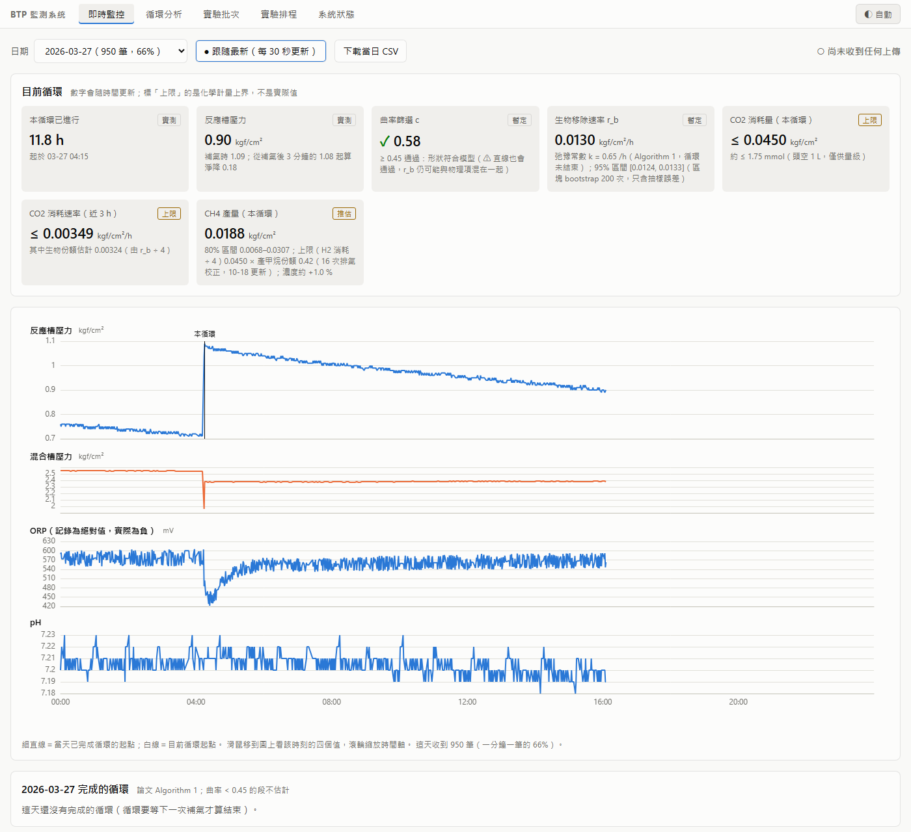

| 國立高雄科技大學_金屬中心_日報 |  |  |  |
|---|---|---|---|
| 時間 | 2026/10/18 | 學生 | 李承育 |
| 地點 | 遠端作業（Jetson Orin NX 經 Tailscale 連線） |  |  |

## 內容與過程註記

### 執行項目

一、研究實驗排程頁上線（Jetson 佇列：可排序、暫緩、改參數、取消、重跑）

二、pH＋壓力分離（NPE）嚴謹版：7 組設定，結論為 pH 只分得出「溶解」

三、溶解量：CO2（由 pH）與 H2（由 Henry 定律）個別計算再加總——合計為壓降的 −9.2%

四、循環內每分鐘的溶解進出（泵週期折疊）

五、每分鐘物理約束神經網路（UDE，PINN 家族）：CO2／H2 進出與每分鐘甲烷產量

六、甲烷產量持續預測：CH4 ＝ H2 消耗 ÷ 4 × 產甲烷份額，逐次更新並接上即時頁

七、本日更正（推翻或降級的先前說法）

### 本日使用方法一覽

| 方法 | 用在哪一項 | 輸入資料 | 驗證／防呆 |
|---|---|---|---|
| 攤銷式神經後驗估計（NPE）：1D-CNN（擴張卷積）→ 雙向 GRU → 注意力池化 → 混合密度網路（6 個全共變異高斯）；組模式另加 DeepSets（平均＋最大池化） | 二 | 機理模擬器 `separation_sim`，疊上 29 個真實循環的殘差模板 | 依模板 3 折交叉驗證、每折 3 種子集成、早停；**先驗偏移測試**（A 訓練、B1／B2 測試）；80% 區間涵蓋率 0.70–0.90 為校準準則；手工特徵＋梯度提升（GBM）基準；無雜訊上限、只用壓力消融、訓練量 3 倍檢查 |
| 碳酸鹽平衡（鹼度固定 → CO2(aq) ∝ [H⁺]）＋ Henry 定律 | 三、四 | 29 個規律循環（τ1／τ5／τ10） | 3 個假設 × 3 個水準共 27 組敏感度；自助法 95% 區間 |
| Nernst 式（H⁺/H2 電對，30 °C 60.15 mV／十倍） | 三 | 同上之 ORP、pH | 物理可行性檢查（液相 H2 飽和度不得 > 1） |
| 泵週期相位折疊（相干疊加）＋以「小時」為單位的區塊自助法 | 四 | 186 個完整小時 | 累積量先逐小時累加再抽樣（區間含分鐘間相關） |
| 通用微分方程（UDE）：質量守恆 ODE、指數積分（步長 0.25 分）、速率律三選一（定速／Monod／神經網路）；Adam → L-BFGS | 五 | 第四項的折疊資料（3 批 × 60 分 × 壓力與 pH 兩通道 = 360 點） | 每版本 3 個起點；χ²／點；AIC；**洩漏份額剖面**；**模擬回收測試** |
| 逐次前推驗證（walk-forward）；卡爾曼局部水準模型；貝氏線性回歸＋遺忘因子 | 六 | 16 個通過化學計量檢查的排氣區間（2025-09 ～ 2026-08） | 每次只用過去資料；與「過去平均」成對比較（自助法區間） |
| 頭空體積反推（預混槽→反應槽的理想氣體質量守恆） | 三、五 | 38 次有效補氣事件 | 依時期分開檢查穩定性 |

### 執行內容如下所示：

---

**1. 研究實驗排程頁上線**

先前研究腳本要從終端機啟動，只有我看得到、也無法調整。今日在前端新增「實驗排程」頁（`/jobs`），
實驗一律送到 Jetson 依序執行。

(1) **功能**：佇列可置頂／前後移、暫緩／恢復、編輯參數（僅限尚未開始者）、取消、複製重跑；
整條佇列可暫停（執行中的跑完、不再啟動下一個）；執行中工作顯示進度與即時紀錄；
歷史表直接列出 NPE 的 R² 與校準結果（圖 6）。

(2) **安全設計**：只能執行白名單內的腳本（目前 5 個範本：NPE 分離、Bi-LSTM 泵標記器、
每分鐘 PINN、甲烷份額更新、錨點排程設計），參數由後端逐一檢查型別與範圍後才組成命令列，
不接受任意指令；一次只跑一個（共用 GPU）；子行程開在獨立 session，結束碼由外層 shell 寫入
檔案，後端重開也能判斷成敗。經查 reactor-web 服務已設定 `KillMode=process`，**重開後端不會
中斷執行中的實驗**。

(3) **部署時發現的問題**：前端解壓用的暫存資料夾 `/tmp/newdist` 繼承了 dist 的唯讀權限而刪不掉，
部署指令鏈在第一步就中斷，但頁面仍回應 200（前端路由的回退頁），**外觀上看不出部署失敗**。
已改用每次新建的暫存資料夾，並以 index 檔的雜湊比對確認新版確實上線。

(4) **今日經佇列執行的工作**：#1 管線測試、#2–#8 NPE 七組、#9 甲烷份額更新、#10 每分鐘 PINN，
全部結束碼 0。

圖 6　實驗排程頁（Jetson 實機截圖）：新增表單由後端參數表自動產生；歷史表列出各工作的耗時與結果摘要。

---

**2. pH＋壓力分離（NPE）嚴謹版**

目的：能否用 pH＋壓力把壓降拆成生物、洩漏、溶解三項。物理上先講清楚：每單位壓降帶走的
CO2，生物約 0.25、整體流洩漏約 0.15–0.2、偏 H2 的洩漏約 0.05，所以 pH 只在洩漏偏 H2 時
才有機會分開生物與洩漏。

(1) **方法**（見方法一覽）。每組 3 折 × 3 種子；單循環訓練 4 萬筆、每個先驗測試 6 千筆；
組模式（8 個循環，τ1 與 τ10 各半，共用生物與洩漏）訓練 8 千組。每組約 1～1.5 小時（Jetson GPU）。

(2) **結果**（3 折平均；圖 1）：

| 設定 | 生物 R²（A／B1／B2） | 洩漏 R²（A／B1／B2） | 溶解 R²（A／B1／B2） | 三折皆校準通過 |
|---|---|---|---|---|
| ① 壓力＋pH、真實雜訊 | 0.58／0.27／0.85 | 0.46／−0.01／0.80 | **0.78／0.75／0.81** | 僅溶解 |
| ② 只用壓力 | 0.43／0.22／0.81 | 0.41／−0.11／0.85 | 0.05／−0.15／0.18 | 溶解（區間過寬，無資訊） |
| ③ 無雜訊上限、壓力＋pH | 0.61／0.32／0.87 | 0.47／0.02／0.82 | 0.88／0.85／0.89 | 僅溶解 |
| ④ 無雜訊上限、只用壓力 | 0.43／0.22／0.81 | 0.41／−0.11／0.84 | 0.04／−0.15／0.16 | 溶解（同②） |
| ⑤ 8 循環跨 τ、無雜訊 | 0.58／0.24／0.85 | 0.43／−0.02／0.81 | 0.94／0.89／0.95 | 僅溶解 |
| ⑥ 8 循環跨 τ、真實雜訊 | 0.55／0.19／0.84 | 0.42／−0.05／0.80 | 0.90／0.83／0.92 | 無 |
| ⑦ 訓練量 12 萬（1 種子） | 0.56／0.25／0.83 | 0.46／0.01／0.80 | 0.77／0.70／0.80 | 無 |

(3) **解讀**：

- **生物與洩漏的「分離」來自先驗，不是資料。** 換成相關結構相反的 B1 測試時，80% 區間只涵蓋
  64–69%（過度自信）；B2 則 95–97%。洩漏在 B1 下 R² ≈ 0，**無雜訊（③）與跨 τ（⑤）也一樣**。
- **瓶頸是資訊本身**：去掉雜訊只多 0.03；訓練量 3 倍沒有變好；跨 τ 對生物／洩漏無幫助
  （兩者都是與 kLa 無關的定速匯，換 τ 看不出差別）。
- **pH 的貢獻是溶解**：只用壓力溶解 R² 0.05，加入 pH 後 0.78，且三種先驗、三折皆校準通過。
- NPE 優於手工特徵 GBM：第 0、1 折生物 R² 0.57 vs 0.29、0.60 vs 0.37，第 2 折相當（0.58 vs 0.57）。
- **真實 29 個循環的溶解**（每個循環只由沒看過其模板的模型推估）：中位 −0.0003 kgf/cm²/hr，
  80% 區間中位寬 0.0032。生物與洩漏因校準未通過，**不報數字**。

(4) **限制**：

- 溶解的校準依賴 3 種子集成；⑦ 只用 1 種子，涵蓋率掉到 0.67。
- 所有組別都跑滿 60 輪、驗證損失仍在下降（未觸發早停）；但⑦ 驗證損失明顯更低（−1.67 vs −0.95）
  而 R² 未升，判斷已飽和。
- 依洩漏選擇性分組，R² 完全沒有差別（三組皆 ≈0.57）。物理上預期偏 H2 的洩漏較易分辨，
  網路並未利用這個機制；可能是模擬器中選擇性造成的 pH 差異小於 pH 計 0.01 的解析度，**尚未查證**。
- 開發時修正一個錯誤：組模式原本只有約 16 次梯度更新（800 組、批次 512、8 輪），R² 為 −2.4；
  改為目標標準化、批次 64 後恢復正常。

圖 1　NPE 七組設定的 R²（上）與 80% 區間實際涵蓋率（下，綠帶為校準通過範圍）。

---

**3. 溶解量：CO2 與 H2 個別計算再加總**

定義：一個循環內，氣體從頭空**存進液相、且沒有被消耗**的量（液相庫存淨變化），換成頭空壓力當量。

(1) **前置確認**：

- ORP 真值範圍 −686 ～ −234 mV（Ag/AgCl），**沒有任何一點為正電位**。
- 補氣後 ORP 會異常往正跳（+37 ～ +123 mV，pH 解釋不了），故**排除補氣後 60 分鐘**，另以 30／90 分做敏感度。
- 液／氣體積比：由 38 次補氣事件反推頭空 1.92 L（四分位 1.55–2.30）、液體 3.08 L
  → V_L/V_G ≈ 1.6（1.2–2.2）。⚠ 槽體 5 L、預混槽 1 L 出自洪博計畫簡報，液位**未經設備方確認**。

(2) **CO2（由 pH）**：鹼度固定、pH ≈ 7.2 時 HCO3⁻ ≈ 鹼度不變，故 CO2(aq)末／CO2(aq)初 ＝ 10^(−ΔpH)，
**不需要知道鹼度**。存入量 ＝ (V_L/V_G)·H_cc,CO2·pCO2·(10^(−ΔpH) − 1)。

(3) **H2（由 Henry 定律）**：液相 H2 隨頭空 H2 分壓（準平衡），存入量 ＝ (V_L/V_G)·H_cc,H2·y_H2·ΔP。
H2 溶解度約為 CO2 的 1/39（H_cc 0.0189 vs 0.741），且菌把液相 H2 壓在低於飽和時實際變化只會更小，
故此值為**幅度上限**。

(4) **為什麼 H2 不用 ORP**：以 Nernst 式把 ORP 換成液相 H2，得到物理上不可能的數字——飽和度最高
2.4 倍（不可能超過 1）；循環內 ORP −304 mV 等於溶解 H2 變 10¹⁰ 倍。此外泵開時 ORP 往**正**
（+11.8／+26.5／+19.7 mV，95% 區間皆不含 0），與 H2 溶入應往負相反。**此 ORP 電極並非依 H2 電對
響應**，不能定量換算。

(5) **結果**（29 個循環；kgf/cm²/hr；正＝存進液相、讓壓力多降）：

| 批次 | 循環數 | 實測壓降 | CO2（pH） | H2（Henry） | 溶解合計 | 消耗 ＝ 壓降 − 溶解 | 溶解佔壓降 |
|---|---|---|---|---|---|---|---|
| τ1 | 7 | 0.0168 | 0.00000 | −0.00041 | −0.00041 | 0.0172 | −2.4% |
| τ5 | 9 | 0.0267 | −0.00165 | −0.00065 | −0.00225 | 0.0302 | −9.2% |
| τ10 | 13 | 0.0286 | −0.00246 | −0.00069 | −0.00304 | 0.0304 | −12.5% |
| **全部** | **29** | **0.0265** | **−0.00194** | **−0.00064** | **−0.00262** | **0.0295** | **−9.2%**（95% 區間 −15.1% ～ −2.4%） |

- CO2 單項為壓降的 −6.8%（−12.6% ～ 0）；27 組敏感度中位落在 −2.9% ～ −12.4%，**沒有一組為正**。
- H2 單項 −2.4%（掃描範圍 −1.7% ～ −3.5%）。此比例由公式決定（∝ V_L/V_G·H_cc·y_H2），非量測所得。
- **結論：溶解沒有讓壓力多降，反而使壓降低估真實消耗約 1 成**；且 τ 越長負值越大。
- 與 ABC（−0.0005）、NPE（−0.0003）同號；但三者皆依賴 pH，**不構成獨立驗證**。

圖 2　(a) 各循環 CO2 存入佔壓降比例；(b) 各循環 pH 與 ORP 的淨變化；(c) 泵開一次 pH 與 ORP 各變多少（ORP 往正）。

---

**4. 循環內每分鐘的溶解進出（泵週期折疊）**

泵每小時固定時刻開 τ 分鐘，將各批數百個小時疊到 0–59 分的同一軸（第 0 分＝開泵），
pH 每分鐘只會跳 0 或 ±0.01，疊加後才有解析度。共 186 個完整小時（τ1 63、τ5 50、τ10 73）。

(1) **壓力**：三批在開泵第 0 分皆驟降約 0.015–0.018 kgf/cm²；**停泵那一分鐘瞬間回升**，τ5、τ10 約 0.009、τ1 約 0.005 kgf/cm²。

(2) **CO2（pH）**：開泵第 0 分 pH 換算的 CO2 存入 +0.26／+0.68／+0.54 kgf/cm²/hr（區間皆不含 0）；
一小時累積最高 +0.014／+0.011／+0.009 kgf/cm²，到下次開泵前回到約 0
（−0.0006／−0.0001／−0.0022，區間皆含 0）。τ5 在第 15 分顯著低於基線（−0.017，區間 −0.023 ～ −0.011），
推測為泵送 H2 後菌把液相 CO2 吃到低於平衡，**未驗證**。

(3) **初步解讀（已於第 5 點修正）**：CO2 只解釋泵開多降壓力的 19–30%；停泵回升時 pH 沒有對應釋出，
故回升不是 CO2。

圖 3　每分鐘速率（上，灰＝頭空壓降、藍＝CO2 存入、橘＝殘差）與液相 CO2 累積存入（下，含 95% 區間）。黃底為泵開時段。

---

**5. 每分鐘物理約束神經網路（UDE）：CO2／H2 進出與甲烷產量**

(1) **為什麼用 UDE 而非經典配點 PINN**：泵開關使 kLa 呈階梯變化，經典 PINN 以平滑網路表示狀態，
階梯處擬合不佳。改用 PINN 家族的通用微分方程：質量守恆寫死為 ODE、以可微分數值積分求解，
**只有菌的吃氣速率律由神經網路學**；物理約束是每一步都成立的硬約束，而非罰項。

(2) **模型**（三批共用設備參數；壓力當量、時間單位為分鐘）：

- 液相 CO2：dc/dt ＝ k_C(t)·(−c) − r
- 液相 H2：dh/dt ＝ k_H(t)·(Heq − h) − 4r
- 頭空：dG/dt ＝ −(CO2 溶入) − (H2 溶入) ＋ r（CH4 回到頭空）− ℓ（洩漏）
- 壓力計讀數 ＝ G − α·[泵開]（α＝泵開時的動壓假象）
- k_C 依泵開／停取 k_on／k_off；k_H ＝ 1.6·k_C（穿透理論 √(D_H2/D_CO2)）
- 速率律 r 三選一：V1 定速（不缺 H2）、V2 Monod（受液相 H2 限制）、V3 神經網路（2→16→16→1）

(3) **擬合品質**（Jetson CPU 平行 7 個行程，773 秒）：

| 速率律 | χ²／點 | 參數數 | AIC | 判斷 |
|---|---|---|---|---|
| V1 定速 | 1.43 | 9 | 533.9 | 最差，且生物份額 > 1（1.13–1.38），不合理 |
| **V2 Monod** | **1.32** | **10** | **493.4** | **採用** |
| V3 神經網路 | 1.29 | 346 | 1154.6 | 改善有限、參數過多 |

每個版本 3 個起點收斂到相同 χ²（V1、V2 完全相同，V3 差 < 3），排除「未收斂」。
→ **菌的吃氣速率受液相 H2 限制**（Monod 比定速好 Δχ² = 42.5，只多 1 個參數），且簡單機制已足夠。

(4) **結果**（V2；圖 4）：

- **泵動壓假象 α ＝ 0.0088 kgf/cm²**，與 τ5、τ10 實測停泵回升約 0.009 吻合 → **停泵回升是量測假象**，不是氣體回到頭空。
- CO2 傳質 k_on ＝ 0.31／分、k_off ＝ 0.013／分。
- **每分鐘甲烷**：以 τ5 為例，開泵時液相 H2 由飽和的約 78% 升到 95%，甲烷產速升約 30%，停泵後緩降。
  一小時平均 ≈ 淨降 ÷ 4 × 份額，三批份額 0.77／0.99／0.81。
- ⚠ **開泵瞬間的 pH 跳動擬合不出來**：實測 CO2 +4 ～ +11（×10⁻³ kgf/cm²），模型在壓力也要吻合的前提下
  只做得出 +0.5 ～ +1.2；且 τ1 在一兩分鐘內就由 +9.5 反轉為 −6.3（化學溶解要約 77 分鐘才放回）。
  → **開泵那一下的 pH 跳動至少部分是電極的流動暫態**，第 4 點「CO2 解釋 19–30%」降級。
  第 3 點每循環淨量取頭尾各 20 分鐘中位數，避開了開泵瞬間，不受影響。

(5) **生物 vs 洩漏：首次有實際約束力，但有前提**：

| 洩漏固定為淨降的 | 0% | 25% | 50% | 75% |
|---|---|---|---|---|
| χ² 比自由解多 | +2.1 | +1.8 | +5.6 | **+19.3（排除）** |

- 回收測試（以洩漏 50% 的擬合為真值、加同等雜訊、洩漏自由重擬合，兩組雜訊 × 三批）：
  0.23／0.42／0.65、0.29／0.70／0.70 → **平均 0.50 無偏，每批誤差約 ±0.2**；
  回收擬合的 χ²／點為 0.93 與 1.03，真實資料為 1.32 → 真實資料含有模型沒有的結構（即上述 pH 暫態）。
- 結論：**這三批的洩漏不超過壓降的約 25–50%**。
- ⚠ **前提是「洩漏不跟著泵變」**。若洩漏點位於泵迴路（泵開時管路加壓、漏得更多），
  模型會把洩漏誤判為生物。洩漏位置目前未知（見待確認事項 1）。

圖 4　UDE（V2 Monod）擬合：上＝頭空壓力每分鐘變化（點＝實測 ± 標準誤、線＝模型）；中＝液相 CO2（pH）；下＝模型推得的每分鐘甲烷產量與液相 H2 飽和度。

---

**6. 甲烷產量持續預測：CH4 ＝ H2 消耗 ÷ 4 × 產甲烷份額**

(1) **化學計量**：4H2 ＋ CO2 → CH4 ＋ 2H2O，每產 1 份 CH4 氣相淨少 4 份，恰為吃掉的 H2，
故 **H2 消耗 ＝ 淨壓降、CH4 ＝ 淨壓降 ÷ 4**（即時頁原有此上限值）。修漏前「消失的 H2」不等於
「菌吃掉的 H2」，需乘以產甲烷份額 s。

(2) **份額 s 的逐次更新**：標籤為 50 個排氣區間中通過化學計量檢查的 16 個（28 個超過上限、6 個無淨降）。
逐次前推（第 5～16 個區間各只用之前的資料預測）：

| 模型 | 份額 MAE | 與「過去平均」比（負＝較好；95% 區間） |
|---|---|---|
| 過去平均 | 0.155 | 基準 |
| 卡爾曼漂移 | 0.161 | +0.006（−0.022 ～ +0.037） |
| ORP 平均 | 0.171 | +0.015（−0.035 ～ +0.067） |
| **ORP 趨勢** | 0.173 | **+0.017（+0.002 ～ +0.032），顯著較差** |
| ORP 兩項 | 0.180 | +0.025（−0.030 ～ +0.082） |
| pH 趨勢 | 0.150 | −0.005（−0.030 ～ +0.020），唯一略好但不顯著 |
| 壓力特徵（消耗速率、每日循環數） | 0.161–0.166 | 皆未勝過 |

- **ORP 無法反推甲烷**：換算 H2 的第一步就不成立（第 3 點），當特徵也比不放更差；與 9/21 ORP 校準結果一致。
- 卡爾曼由過去資料選出的漂移量為最小值 → 歷史上份額**沒有可預測的漂移**，差異主要是標籤雜訊。
- 目前份額 **0.42（80% 區間 0.15 ～ 0.68）**。

(3) **上線**：即時頁新增「CH4 產量（本循環）」（圖 7）：校正值 ＋ 80% 區間 ＋ 上限（H2 消耗 ÷ 4）。
新排氣量測後，重跑 `bio_activity_timeline.py` 更新標籤，再於排程頁執行「甲烷份額模型：逐次更新」
（4 秒），即時頁即改用新份額——**前一次的量測推進下一次的預測**。
⚠ 圖 7 為 Jetson 上目前最新的資料（2026-03-27 測試資料），反應器尚未上線。

(4) **未解矛盾**：同為 7 月資料，份額有三個估計——
三批化學計量對帳 0.67–0.87、第 5 點 UDE 0.77–0.99（洩漏上限推出至少約 0.5）、
16 區間序列中 7/30 區間 0.24。前兩者一致，**排氣序列的錨點或消耗量定義可能有誤**，待查。
在查清前，即時頁甲烷值可能有約 2 倍的不確定。

圖 5　(a) 逐次前推：黑＝實測份額，虛線＝各模型只用之前資料的預測，藍帶＝卡爾曼 80% 區間；(b) 各模型前推誤差。

圖 7　即時監控頁（Jetson 實機截圖）：「CH4 產量（本循環）」顯示校正值、80% 區間、上限與份額來源。

---

**7. 本日更正**

| 先前說法 | 更正 | 依據 |
|---|---|---|
| 泵開時 ORP 往負約 21 mV（10/16 日報第 8 點、`orp_event_decay_v2.py` 說明） | **泵開時 ORP 往正** +12／+27／+20 mV | 第 3 點，197 次泵開事件直接量測；舊數字疑為泵後最低點 |
| 「驟降後回升 1/3～1/2」是 CO2 可逆溶解（本日稍早） | **停泵回升是泵動壓假象**（α ＝ 0.0088） | 第 4、5 點 |
| CO2 解釋泵開多降壓力的 19–30%（本日稍早） | 降級：開泵瞬間 pH 跳動至少部分為電極暫態 | 第 5 點 |
| 菌的消耗不會跟著泵的分鐘變化（每分鐘折疊的假設） | 不成立：菌受 H2 傳質限制，消耗跟著泵 | 第 5 點 Monod 勝出 |
| NPE 組模式 R² −2.4 | 為訓練不足的程式錯誤，已修正 | 第 2 點 |

### 待辦事項

1. **查清份額矛盾**（第 6 點）：比對 7/30 區間在排氣序列與化學計量對帳兩邊的錨點時刻與消耗量定義。
2. **修漏當日重設甲烷份額模型的先驗**：歷史份額無漂移，模型不會自行跟上修漏後應接近 1 的份額。
3. 修漏前後對照（承 10/16）：UDE 的洩漏剖面可直接比較修漏前後；修後洩漏應 → 0、生物份額 → 1。
4. 查證 NPE 模擬器中洩漏選擇性造成的 pH 差異是否低於 0.01 解析度（第 2 點限制）。
5. 每分鐘 pH 暫態：比對 pH 電極位置與泵出口的相對位置，若電極在流路上可解釋第 5 點的暫態。
6. Henry 常數、擴散係數等教科書值寫入論文前查證來源並驗證 DOI。
7. Jetson 的 matplotlib 缺中文字型（圖改在筆電以輸出檔重畫）；需安裝或指定 Noto Sans CJK。

### 待確認事項

1. **洩漏位置**：在泵迴路上，還是槽體／接頭／供氣端？決定第 5 點「洩漏 ≤ 25–50%」能否採用；另請告知預計修好時間。
2. **反應槽液體體積**（目前反推約 3.08 L、頭空約 1.92 L）：溶解量與 H2 存入量皆與液／氣體積比等比例。
3. **補氣管路是否先排空**：補氣後 ORP 往正跳的候選原因之一為管路死體積帶入空氣。
4. pH 電極是否位於泵的循環流路上（第 5 點電極暫態）。

### 補充

- 研究程式：`research/ml/npe_separation.py`、`research/cycles/dissolution_two_channel.py`、
  `research/cycles/dissolution_per_minute.py`、`research/ml/pinn_minute_dissolution.py`、
  `research/ml/ch4_sequential.py`、`research/figures/fig_daily_1018.py`
- 結果：`research/ml/out_npe/job2～job8_*`、`docs/analysis/dissolution_two_channel/`、
  `docs/analysis/dissolution_per_minute/`、`research/ml/out_pinn_minute/`、`research/ml/out_ch4_seq/`
- 系統：`edge_backend/core/research_jobs.py`、`edge_backend/api/research_routes.py`、
  `web_frontend/src/views/JobsView.vue`；即時頁甲烷校正 `edge_backend/core/cycle_sync.py`
- 圖：`docs/reports/fig_daily_1018/`
- 本日程式與文件尚未 commit
