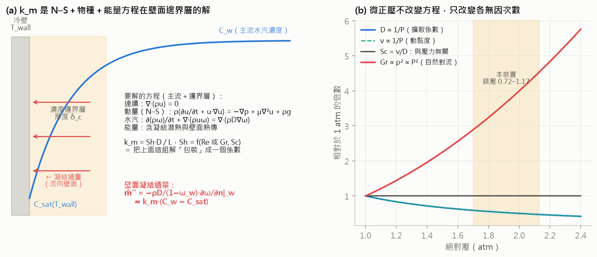
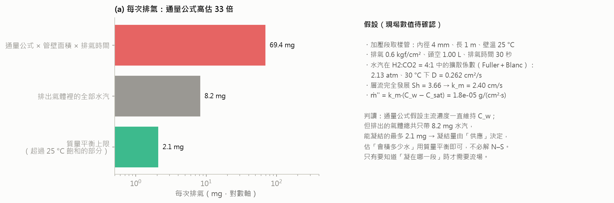
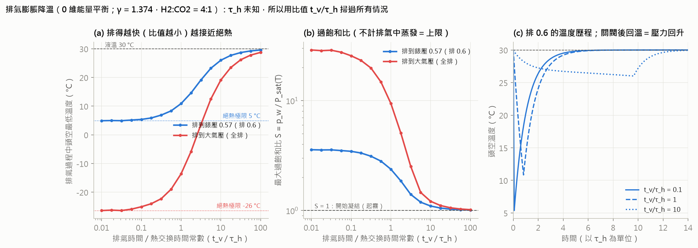

# 公式與演算法總整理

2026-10-17。本案目前程式裡實際在用的公式、常數與演算法，**全部對照程式碼抄出**（每節標出處）。
改程式時請同步改這份；兩者不一致時以程式為準。

---

## 0　符號、單位與常數

| 符號 | 意義 | 單位 |
|---|---|---|
| $P$ | 反應槽錶壓（CSV 第 11 欄） | kgf/cm² |
| $P_{abs}$ | 絕對壓 $=P+1.033$ | kgf/cm² |
| $t$ | 補氣後經過時間 | 小時 |
| $k$ | 弛豫常數（包絡的一階速率，含 kLa） | 1/小時 |
| $r_b$ | 零階移除速率（論文稱生物移除；**含洩漏**，見第 8 節） | kgf/cm²/小時 |
| $P_{eq}$ | 平衡壓 | kgf/cm² |
| $A$ | 指數項振幅 | kgf/cm² |

| 常數 | 值 | 出處 |
|---|---|---|
| 大氣壓 ATM | 1.033 kgf/cm² | `edge_backend/core/descent_report.py` |
| 壓力量化階 QUANT | 0.01 kgf/cm² | 同上 |
| 1 kgf/cm² | 98066.5 Pa | 同上 |
| 氣體常數 R | 8.314462618 J/(mol·K) | 同上 |
| 頭空體積 | 1.00 L（四分位 0.60–2.14，只能看量級） | 同上 |
| 化學計量上限 | CH4／總壓降 ≤ 0.25 | 同上 |
| 溫度 | 30.0 °C（設定點，非實測） | CSV 第 10 欄 |

---

## 1　資料前處理

### 1.1 欄位與 ORP 符號（`research/multivariate_increments.py`）

- 欄 7 ＝ ORP、欄 9 ＝ pH、欄 11 ＝ 反應槽壓力、欄 8 ＝ 混合槽壓力；欄 12/13（CO2/CH4）99.98% 為無效拖尾。
- 記錄器只存絕對值：$\mathrm{ORP}_{真} = -\,\mathrm{ORP}_{記錄}$
- 換算到標準氫電極：$E_{SHE} = E_{Ag/AgCl} + 197$ mV（中位 −554 → −357 mV vs SHE）

### 1.2 ORP 即時處理（`edge_backend/core/signal_processor.py`）

1. **突波偵測**：一階差分 $\Delta x_t = x_t - x_{t-1}$；若 $\Delta x_t < \theta_{drop} = -20$ mV/分 → 進入突波狀態。
2. **突波結束**：$x_t \ge 0.90\,x_{start}$ 且 $\Delta x_t>0$，或緩衝滿 15 分鐘（逾時強制恢復）。
3. **緩衝區線性內插**（$n$ 為緩衝筆數，$i=0,\dots,n-1$）：
   $$\hat{x}_i = x_{start} + (x_{end}-x_{start})\,\frac{i+1}{n}$$
4. **指數移動平均**：$\mathrm{EMA}_t = \alpha x_t + (1-\alpha)\,\mathrm{EMA}_{t-1}$，$\alpha = 2/(N+1)$，$N=10$。

### 1.3 去重與排除

- 跨資料夾依**時間戳**去重（原始 CSV 有重複副本；351 檔只有 251 相異）。
- 洗管線日：一天內循環起始超過 6 次（`WASH_PER_DAY = 6`）的整天排除。

---

## 2　循環切段（`edge_backend/core/cycle_estimator.py: segment`）

逐點掃描，維護「目前段的最低壓」valley：

- 取樣中斷 $h_i - h_{i-1} > 1$ 小時 → 強制切段。
- 補氣：$P_i - \text{valley} > 0.03$ → 切段（補氣在一分鐘內就遠超門檻，不需變點偵測）。
- 保留條件：段長 ≥ 4 小時，且落差 $P_{起}-P_{終} \ge 0.10$。
- 每段開頭掐掉 `SKIP_MIN` ＝ 3 分鐘（補氣本身）。
  ⚠ 必須用該段自己的整數秒時間軸（`exact_time`），否則第 180 秒那筆會因浮點誤差被誤掐。

---

## 3　Algorithm 1：單段估計（`cycle_estimator.py`）

### 3.1 模型

$$P(t) = P_{eq} + A\,e^{-kt} - r_b\,t$$

### 3.2 曲率預篩

$$c = \mathrm{interp}\!\left(0.5;\ \frac{t-t_0}{t_{end}-t_0},\ \frac{y_0-y(t)}{y_0-y_{end}}\right),\qquad \text{通過條件 } c \ge c^* = 0.45$$

$c$ ＝「時間過一半時，已完成總壓降的幾成」。實際數值（2026-10-17 以 `ce.curvature` 驗算）：

| 形狀 | $c$ | 篩選 |
|---|---|---|
| 純直線（只有 $r_b$） | 0.500 | **通過** |
| 指數＋直線，$k=0.1$ | 0.584 | 通過 |
| 指數＋直線，$k=0.5$ | 0.829 | 通過 |
| 指數＋直線，$k=1.5$ | 0.888 | 通過 |
| 後段加速（凸形） | 0.250 | 擋掉 |

⚠ **更正（2026-10-17）**：程式註解、即時頁與本文件原本寫「$c$ 小＝太直、分不開」，**這是錯的**。直線的 $c=0.5$ 會通過；被擋掉的是 $c<0.45$、即壓降集中在後半段（越降越快）——這種形狀是模型 $A\ge0,\ k>0,\ r_b\ge0$ 根本產生不了的（模型只能給 $c\ge0.5$，0.45 留給雜訊）。
所以曲率篩選擋的是「彎錯方向」，**不擋直線**；直線段的簡併（$Ae^{-kt}$ 與 $-r_bt$ 互換）仍留在資料裡，這正是 $\hat k$ 撞網格端點與 Algorithm 2 存在的原因。

### 3.3 剖面最小平方（fit_le）

$k$ 在網格 `KGRID` $= \{0.01, 0.03, \dots, 2.99\}$（150 點）上窮舉；固定 $k$ 後對 $(A, r_b, P_{eq})$ 為線性：

$$\min_{A,r_b,P_{eq}} \sum_i \left(y_i - [A e^{-kt_i} - r_b t_i + P_{eq}]\right)^2,\qquad \hat{k}=\arg\min_k \mathrm{SSE}(k)$$

殘差標準差 $s = \sqrt{\mathrm{SSE}/(n-4)}$。
⚠ $\hat k$ 落在網格端點（0.01 或 2.99）＝殘差在網格內沒有內部極小，資料約束不了 $k$，$\hat r_b$ 不可採信（論文 207 段中約 48 段）。

### 3.4 批次版（BatchFitter，給模擬與 bootstrap）

同一條時間軸 $t$ 上一次擬合 $m$ 條曲線。每個 $k_j$ 預先做 QR：$X_j = Q_jR_j$，$X_j=[e^{-k_jt},\ t,\ \mathbf 1]$。
$y$ 先去平均（含常數項，SSE 不變）：

$$\mathrm{SSE}_j(y) = \|y_c\|^2 - \|Q_j^\top y_c\|^2,\qquad \hat\beta = R_{\hat j}^{-1} Q_{\hat j}^\top y_c$$

⚠ **不可改用正規方程**：$k$ 很小時 $e^{-kt}\approx 1-kt$ 與常數項、$t$ 共線，正規方程把條件數平方，真實資料有 4/242 段 $\hat k$ 算錯。⚠ 一律 float64（GPU fp32 實測 $\hat k$ 只 59/207 相同）。

### 3.5 即時區間：區塊 bootstrap（`bootstrap_rb`）

1. 以 fit_le 擬合，得配適值 $\hat y$ 與殘差 $e$。
2. 殘差切成約 30 分鐘的區塊（區塊長 $L=\mathrm{round}(30/\Delta t_{分})$），隨機起點重抽拼回 $n$ 點：$y^{*}=\hat y + e^{*}$（重抽 200 次）。
3. 每組 $y^*$ 以 BatchFitter 重擬，取 $\hat r_b^*$ 的 2.5%／97.5% 分位數；另報 $\hat k^*$ 撞網格端點的比例。

用區塊而非逐點：殘差 lag-1 自相關 0.26，逐點重抽會讓區間窄得不實。⚠ 只含抽樣誤差，不含簡併偏誤。

---

## 4　Algorithm 2：簡併基準（`research/paper_tests.py: algorithm2`）

對每段實測擬合取 $(\hat k, \hat A, \hat P_{eq}, \hat r_b, s, \phi)$，其中殘差 lag-1 自相關放大 $\phi = \mathrm{clip}(1.3\,\rho_1,\,0,\,0.98)$、$s\ge \text{QUANT}/4$。
以實測重新合成、量化、再用 fit_le 擬合（**不篩曲率**，照原程式）：

$$y^{sim}(t) = \hat P_{eq} + \hat A e^{-\hat kt} - r_b^{真}\,t + z_t,\qquad z_t = \phi z_{t-1} + \varepsilon_t,\ \ \varepsilon_t\sim\mathcal N(0,\ s^2(1-\phi^2))$$

三種真值設定：

| 基準 | $r_b^{真}$ | 用途 |
|---|---|---|
| B0 | $R_0 = \mathrm{median}(\hat r_b)$（恆定） | 恆定真值下，簡併本身造成多少 $\rho(\hat r_b,\hat k)$ |
| B1 | $R_0 + \mathcal N(0, \mathrm{sd}(\hat r_b)^2)$ | 隨機變動的真值 |
| B2 | $a + b\ln \hat k$（實測對 $\ln k$ 迴歸） | 真值隨 $k$ 變 |

每種重複 NREP＝25 次（種子 112358），報 Spearman $\rho$ 平均與中位數偏誤 $\mathrm{bias}=(\overline{\mathrm{med}}/\text{truth}-1)\times100\%$。

---

## 5　Algorithm 3：純物理虛無（`paper_tests.py: algorithm3`）

1. 每段以 $r_b\equiv0$ 的兩參數模型擬合：$P(t)=P_{eq}+Ae^{-kt}$。
2. 合成 $z(t)=\hat P_{eq}+\hat Ae^{-\hat kt}+\mathrm{AR}(1)$，量化；**曲率未過 0.45 的捨棄**；其餘以 fit_le 得 $\hat r_b$。
3. 每次抽樣取各段 $\hat r_b$ 的中位數；共 $D$ 次（論文 $D=41$，種子 112358）。

$$p = \frac{1 + \#\{\mathrm{med}^{null}_d \ge \mathrm{med}^{obs}\}}{1 + D}$$

$D=41$ 時 $p$ 最小只能到 $1/42=0.024$；快速模式 $D=2000$ 得 $p=1/2001$。
⚠ 此檢定排除的是「純物理」，**不能排除洩漏**（洩漏與生物同為定速項）。

---

## 6　校準與頭條數字（`edge_backend/calibration.json`、`cycle_estimator.apply_calibration`）

$$r_b = \hat r_b\,(1 + c),\qquad c = -0.048$$

頭條：$r_b = 0.0125$ [0.0112, 0.0139]，n = 207，相容 β ∈ [0.15, 0.80]，null p = 0.024。

---

## 7　化學計量與換算

### 7.1 上限（`edge_backend/core/cycle_sync._stoich`）

反應 $\mathrm{CO_2} + 4\mathrm{H_2} \to \mathrm{CH_4} + 2\mathrm{H_2O(l)}$：氣相每轉換 1 莫耳 CO2 淨少 4 莫耳。

$$\mathrm{CO_2\ 消耗} = \mathrm{CH_4\ 產量} \le \frac{\Delta P_{淨}}{4},\qquad x_{CH_4} \le \frac{\Delta P_{淨}/4}{P_{abs}}$$

$\Delta P_{淨}$ 從補氣後 3 分鐘起算。H2 消耗 ≤ $\Delta P_{淨}$。**全部是上限**（壓降還含物理項與洩漏）。

### 7.2 莫耳換算（`descent_report.moles_from_pressure`）

$$n = \frac{\Delta P\cdot V}{R\,T},\quad \Delta P[\mathrm{Pa}] = 98066.5\,\Delta P[\mathrm{kgf/cm^2}],\ V = 1.00\ \mathrm{L},\ T = 303.15\ \mathrm K$$

頭空體積的估法：閥開時 $V_{premix}\,\Delta P_{premix} = V_{head}\,\Delta P_{reactor}$，$V_{premix}=1$ L，71 次配對事件中位 1.00 L。

### 7.3 排氣甲烷對帳的生物份額（`descent_report.stoichiometry`）

$$\Delta p_{CH_4} = f_2\,(P_2+1.033) - f_1\,(P_1+1.033),\qquad \text{生物份額} = \frac{\Delta p_{CH_4}/\Delta P_{總}}{0.25}$$

$f_1,f_2$ 為兩次排氣瞬間的 CH4 分率（只有排氣瞬間可信）。不需要頭空體積。
份額 > 1 或 $\Delta p_{CH_4}<0$ → 讀數有誤。目前：50 個排氣區間中 16 個通過，**中位 40%**（四分位 29–49%）。

---

## 8　殘餘組成檢定（氫氣超量流失）

### 8.1 Sabatier 不變量（`research/cycles/feed_ratio_drift.py`）

進料 CO2:H2 = 1:4 ＝ 消耗比 → 只有產甲烷時，殘餘比恆為
$$\frac{x_{CO_2}}{x_{H_2}} = 0.25$$
偏高 → H2 被額外移除；偏低 → CO2 被額外移除（溶解）。實測 35 次中 34 次偏高，中位 1.33–2.79 倍。

### 8.2 超量 CO2 壓力當量（`research/cycles/topup_gas_identity.py`）

$$E = P_{abs}\,(x_{CO_2} - 0.25\,x_{H_2})$$

| 過程 | $dE$ |
|---|---|
| 只有產甲烷 | 0（不變量） |
| 補入 $d$ 莫耳、組成 $(c,h)$ | $(c-0.25h)\,d$ |
| CO2 溶解 $d$ | $-d$ |
| 碳酸鹽脫氣 $d$ | $+d$ |
| H2 洩漏 $L$ | $+0.25L$ |

排氣對之間 $dE$ 對補氣壓力增量迴歸，斜率 $=c-0.25h$；換算有效補氣比
$$r_f = \frac{\text{斜率} + 0.25}{1 - \text{斜率}}$$
（$E$ 與補氣量皆正比於頭空體積 → 斜率與體積無關。）實測 $r_f$ ≈ 1:3.85。⚠ 同等大小的 H2 洩漏給出相同斜率，分不開。

### 8.3 碳酸鹽緩衝（`research/cycles/carbonate_degassing_test.py`）

$$\frac{[\mathrm{HCO_3^-}]}{[\mathrm{CO_2(aq)}]} = 10^{\,\mathrm{pH} - 6.35}\quad(\mathrm{pH}=7.20 \Rightarrow 7.1)$$

---

## 9　pH 與 ORP

### 9.1 Nernst 校正（`research/cycles/orp_event_decay_v2.py`）

H2/H⁺ 電對：$E = E_0 - \frac{2.303RT}{F}\mathrm{pH} - \frac{2.303RT}{2F}\log p_{H_2}$；30 °C 時 $\frac{2.303RT}{F}=60.1$ mV。
$$E_{pH校正} = E + 60.1\cdot\mathrm{pH}$$
另以資料估實際 $dE/d\mathrm{pH}$（電極未必理想）。

### 9.2 ⚠ 常數不一致（待修）

`research/ml/separation_sim.py` 用 `NERNST_PH, NERNST_H2 = 61.1, 30.6`（註明 35 °C），但反應器設定 30 °C（應為 60.1、30.1）。只影響模擬的 ORP 特徵；ORP 已判定無可用資訊，結論不受影響，但數值應統一。

---

## 10　PINN（`research/cycles/pinn_rb_recovery.py`、`research/ml/pinn_batched.py`）

兩個網路 $\hat P(t)$、$\hat r_b(t)$（$\hat r_b=\mathrm{softplus}(\cdot)\ge0$），可學純量 $\ln k_{La}$、$P_{eq}$；時間正規化 $\tau=t/T$。

$$\mathcal R(\tau) = \frac{d\hat P}{d\tau} + k_{La}\,(\hat P - P_{eq}) + \hat r_b(\tau)$$

$$\mathcal L = \frac{\langle(\hat P - P^{obs})^2\rangle}{s_c} + \frac{\langle\mathcal R^2\rangle}{s_c} + \lambda\,\frac{\langle(d\hat r_b/d\tau)^2\rangle}{s_c},\qquad s_c=(P_0-P_1)^2$$

（$\langle\cdot\rangle$ 表示對所有時間點取平均。）

最佳化：Adam 4000 步 → L-BFGS 400 步（strong-Wolfe）；批次版為每模型獨立的 L-BFGS，fp32＋fp64 收尾。
剖面用：加 $10^4(\langle\hat r_b\rangle - r_b^{目標}T)^2/s_c$ 釘住平均。

**可辨識的只有組合**（穩態時 $dP/dt\to0$）：
$$A_{\infty} = P_{eq} - \frac{\bar r_b}{k_{La}}$$
真實 29 個循環中 24 個的 $A$ 被鎖死（範圍 ≤ 0.005），$\bar r_b$ 本身散布兩個數量級——與 Simpson & Baker (2024) 第 4 節「只有參數組合可辨識」同一結構。

---

## 11　機理模擬（`research/ml/separation_sim.py`）

狀態：$h$（H2）、$c$（CO2 氣相）、$m$（CH4）、$n$（惰性）、$L$（液相 CO2，以氣相壓力當量計）。

$$x = L/\gamma,\quad F = k_{La}(t)\,\gamma\,(c-x),\quad R = k_b\,h\,\frac{x}{x+K_x},\quad \text{漏}_i = \lambda\,w_i\,p_i$$

$$\dot h = -4R - \text{漏}_h,\quad \dot c = -F - \text{漏}_c,\quad \dot m = R - \text{漏}_m,\quad \dot n = -\text{漏}_n,\quad \dot L = F - R$$

總壓降 ＝ $(F-R) + 4R + \text{漏}$ ＝ 溶解 ＋ 生物 ＋ 洩漏（三者恰好相加）。$w_i$ 介於整體流與 Graham 擴散（$\propto 1/\sqrt{M_i}$）之間。

量測：$P = h+c+m+n-1.033$；$\mathrm{pH} = \mathrm{pH}_0 - \log_{10}(x/x_0)$；$\mathrm{ORP} = O_0 - 61.1(\mathrm{pH}-\mathrm{pH}_0) - 30.6\log_{10}(h/h_0)$（見 9.2）。
雜訊：借真實循環同時段的三通道殘差（N1 中度／N2 保守），再量化。先驗 A（獨立）訓練、B1／B2（相關結構相反）測試。

---

## 12　pH ABC（`research/ml/ph_abc.py`）

近似貝氏計算：參考表＝先驗 A 的模擬（答案已知）；摘要統計量為壓力＋pH 特徵（不用 ORP）。

1. 距離以參考表的 MAD 標準化，接受最近的 $q$ 比例（1–6%）。
2. 局部線性迴歸校正（Beaumont 2002，Epanechnikov 權重）→ 後驗中位數與 80% 區間。
3. **留一模板**：推估真實循環 $j$ 時，排除以 $j$ 為模板的模擬。
4. **必須先過校準**：以 B1／B2 模擬當假真實資料，80% 區間的實際涵蓋率要約 80%。

結果：溶解通過校準（78%／75%），真實循環溶解 ≈ 0；生物與洩漏校準失敗，不可引用其比例。

---

## 13　泵與 τ 相關

### 13.1 逐分鐘剖面與泵窗（`research/cycles/pump_rhythm.py`）

只用間隔約 1 分鐘、非補氣的相鄰筆，依「小時內第幾分」分組平均壓降 $\mu_m$（$m=0..59$）：

$$\text{開泵分} = \arg\max_m \mu_m,\quad \text{停泵分} = \arg\min_m \mu_m,\quad \text{運轉} = (\text{停}-\text{開}) \bmod 60$$

⚠ 不可用「超過幾倍 MAD」的門檻法（尖峰撐大尺度，只抓得到一分鐘）；不可逐「小時」看（雜訊淹沒），要逐日。
置換檢定：打散分鐘標籤 2000 次，比較全日極差。

### 13.2 泵停期速率（`research/cycles/pump_mode_split.py`）

$r_{off}$＝連續安靜段（泵停、頭尾各留 2 分保護帶）的逐分鐘平均降速；實測 0.0100／0.0104／0.0090。

### 13.3 Bi-LSTM 泵標記器（`research/ml/pump_tagger.py`）

- 輸入（逐分鐘）：$\Delta P,\ \Delta\mathrm{ORP},\ \Delta\mathrm{pH}$ 以 MAD 穩健標準化 $z=(x-\tilde x)/(1.4826\,\mathrm{MAD})$，截斷 ±50，加斷點旗標；**不含**小時內第幾分。
- 標籤：逐日泵窗（13.1）；補氣 $\Delta P > 0.03$；3 月無泵期為負對照。
- 模型：2 層 Bi-LSTM（hid 32），3 類交叉熵，類別權重 $w_c = N/(3N_c)$；序列 180 分。
- 驗證：留一 τ 批；指標為逐分鐘 F1、逐小時運轉分鐘絕對誤差、無泵期誤報率。

---

## 14　軟感測器採樣設計（`research/ml/softsensor_anchor_design.py`）

錨點＝兩次排氣間 $r_{bio}$ 的區間平均（含 15% 誤差）。逐小時嵌入 $e(h)$ 先做 24 小時置中移動平均、標準化、PCA 到 8 維。
設計列取區間內嵌入的平均 $\bar x = [1,\ \overline{e}_{[a,b)}]$，以貝氏線性迴歸擬合：

$$S = (P_0 + X^\top X/\sigma^2)^{-1},\qquad m = S\,X^\top y/\sigma^2,\qquad \sigma = 0.15\,\bar y$$

先驗精度 $P_0=\mathrm{diag}(10^{-4}, \alpha, \dots)$ 以邊際概似從 $\alpha\in\{0.3,\dots,300\}$ 挑（Woodbury，只解 $d\times d$）：

$$\log p(y) \propto -\tfrac12\left[\log|P_0+G| - \log|P_0| + y^\top y/\sigma^2 - b^\top(P_0+G)^{-1}b\right],\quad G=X^\top X/\sigma^2,\ b=X^\top y/\sigma^2$$

線上策略：資訊增益（$\bar x^\top S\bar x/\sigma^2>\theta$ 就排氣）、新穎度（與已錨定列的最小距離 $>\theta$）；$\theta$ 以二分搜尋取「仍用得完預算 $N$」的最嚴值。
評分：日平均 $r_{bio}$ 的相對 RMSE。

---

## 15　其他估計量

| 方法 | 公式／做法 | 出處 |
|---|---|---|
| 生物活性時間軸 | 每循環最小平方斜率；80% 區間＝30 分鐘區塊重抽；CO2 轉換＝CH4 生成＝降速 ÷ 4（假設無洩漏的上限） | `research/cycles/bio_activity_timeline.py` |
| 尾段斜率（kT>7） | 只取 $e^{-kT}<0.001$ 的段，從 $t_0=4.6/k$ 之後量斜率（指數項已衰減 99%） | memory: tail_slope_highkT |
| 設定點自然實驗 | 2026-07-11 前後比較 $\hat k$、$\hat r_b$（Mann-Whitney）；物理跳、生物不跳，MDE 59% | `research/cycles/setpoint_rd.py` |
| CH4 計量硬上限 | $\mathrm{CH_4}/\text{消耗} \le 0.25$，三批 0.217／0.168／0.193 | memory: ch4_stoichiometric_check |
| 碳源耗盡天然實驗 | CO2 尚存 vs 歸零的逐循環速率比較（p = 0.21，0.0125 下檢定力 100%） | `research/cycles/co2_exhaustion_test.py` |

---

## 16　水汽與凝結（2026-10-18 加入）

### 16.1 凝結條件

只要水汽分壓大於等於**最冷接觸面溫度**下的飽和水汽壓，就會在該面凝結（露點）：

$$P_w \ge P_{sat}(T_{wall})$$

飽和水汽壓以 Antoine 式計算（水，1–100 °C）：

$$\log_{10} P_{sat}[\mathrm{mmHg}] = 8.07131 - \frac{1730.63}{233.426 + T[^\circ\mathrm C]}$$

### 16.2 凝結通量

$$\dot m'' = k_m\,(C_w - C_{sat}(T_{wall}))$$

$k_m$ 為對流質傳係數（與流速、擾動有關，需以經驗式估或實測；手邊沒有數值）。本案水汽只佔約 2%，H2、CO2、CH4 等不凝結氣體下此線性式適用。

### 16.3 本案條件下的數值（液溫 30 °C）

| 項目 | 數值 |
|---|---|
| $P_{sat}(30\,^\circ\mathrm C)$ | 4.23 kPa ＝ 0.043 kgf/cm² |
| 頂空水汽莫耳分率 $y_w = P_{sat}/P_{abs}$ | 1.96%（錶壓 1.17）～ 2.46%（錶壓 0.72） |
| 加壓管路的露點 | **30 °C**（頂空接觸 30 °C 液面，本來就飽和） |
| 排氣降到 1 atm 後 $P_w = y_w \times 101.3$ kPa | 1.98–2.49 kPa → 露點 **17.4–21.1 °C** |
| 每排氣 0.6 kgf/cm²（頭空 1.00 L）帶走的水 | $n_{gas}=23.3$ mmol × $y_w$ ≈ 0.46 mmol ≈ 8 mg |
| 產甲烷生成的水（$\mathrm{CO_2}+4\mathrm{H_2}\to\mathrm{CH_4}+2\mathrm{H_2O}$，以 $r_b/4$ 計） | 約 4.4 mg/h，生成在液相 |
| 溫度變化 1 °C 造成的 $P_{sat}$ 變化 | 0.24 kPa ＝ 0.0025 kgf/cm²（約四分之一個量化階） |

### 16.4 穩態與最小排氣量公式為何不適用

常見的穩態式 $C_{eq} = \dot m_{gen}/Q$ 與由它導出的

$$Q_{min} = \frac{\dot m_{gen}\,R\,T}{M_w\,P_{sat}(T_{wall})}$$

假設水汽以**與排氣量無關的固定速率**產生。本反應器的頂空接觸 30 °C 液面，水會持續蒸發補到飽和，排出的氣體永遠是飽和的：$P_w = P_{sat}(30\,^\circ\mathrm C)$。
因此在加壓段，只要壁面低於 30 °C，**排氣量再大都會凝結**，$Q_{min}$ 無解。另外本系統是密閉批次（補氣／排氣間歇），不是連續排氣。

### 16.5 可行的對策（現場數值由使用者／洪博決定）

1. 加壓段管路與感測器保溫或加熱到 30 °C 以上（例如 32–35 °C）。
2. 讓凝結發生在指定位置：感測器前加冷凝收集瓶或除濕元件（如 Nafion 管、矽膠），管路坡向反應器。
3. 利用減壓：排氣閥之後露點只剩 17–21 °C，氣體感測器放在減壓後、環境 > 約 22 °C 處即不凝結。

⚠ 待查的假設：CO2／CH4 讀數 99.98% 為無效拖尾、且為滯後追蹤，可能與取樣管路積水有關（未驗證）。
水汽壓是固定偏移（30 °C 恆溫下不影響壓降速率）；但溫度實際上沒有量測（CSV 第 10 欄為設定點）。

### 16.6 $k_m$ 與 Navier–Stokes 的關係

$k_m$ 不是常數，而是「連續＋動量（N–S）＋水汽物種＋能量」四組守恆方程在壁面邊界層的解，被壓成一個係數：

$$\dot m'' = -\frac{\rho D}{1-\omega_w}\left.\frac{\partial\omega}{\partial n}\right|_w \approx k_m\,(C_w - C_{sat}),\qquad k_m = \mathrm{Sh}\cdot\frac{D}{L},\quad \mathrm{Sh}=f(\mathrm{Re}\ \text{或}\ \mathrm{Gr},\ \mathrm{Sc})$$

**微正壓不改變方程，只改變無因次數：**

| 檢查項 | 本裝置 | 意義 |
|---|---|---|
| 馬赫數 | 遠小於 0.3 | 不可壓縮 N–S（Boussinesq）即可 |
| 連續體 | 平均自由徑遠小於管徑 | 不需稀薄氣體理論 |
| $D \propto 1/P$、$\nu \propto 1/P$ | — | $\mathrm{Sc}=\nu/D$ **與壓力無關** |
| $\mathrm{Gr} \propto \rho^2 \propto P^2$ | 2.13 atm | 自然對流比常壓強約 4.5 倍 |
| 水汽莫耳分率 | 約 2% | Stefan 修正約 3%，線性式適用 |

擴散係數（Fuller 相關式＋Blanc 混合律，程式計算）：$D_{\mathrm{H_2O-H_2}}=0.933$、$D_{\mathrm{H_2O-CO_2}}=0.215$ cm²/s（1 atm、30 °C）；H2:CO2 = 4:1、2.13 atm 下 $D=0.262$ cm²/s。
常用關聯式：管內層流完全發展 $\mathrm{Sh}=3.66$；垂直壁自然對流 $\mathrm{Sh}=0.59(\mathrm{Gr}\,\mathrm{Sc})^{1/4}$；氣體靜止時為純擴散。

### 16.7 凝結量由「供應」決定，不是由通量公式決定

| 每次排氣（排 0.6 kgf/cm²、頭空 1.00 L；假設管徑 4 mm、長 1 m、壁溫 25 °C、排氣 30 秒） | 數值 |
|---|---|
| $k_m = 3.66\,D/d$ | 2.40 cm/s |
| 通量 $\dot m''$ | 1.8×10⁻⁵ g/(cm²·s) |
| 通量 × 管壁面積 × 排氣時間 | 69.4 mg |
| 排出氣體裡的全部水汽 | 8.2 mg |
| **質量平衡上限**（超過壁溫飽和的部分） | **2.1 mg** |

$$m_{凝結} \le n_{排出}\,y_w\,M_w\left(1-\frac{P_{sat}(T_{wall})}{P_{sat}(T_{液})}\right)$$

通量公式假設主流一直維持 $C_w$，高估約 33 倍。**估「會積多少水」用質量平衡即可，不必解 N–S**；只有要知道「凝在哪一段」時才需要流場（CFD）。

### 16.8 循環裝置特有：排氣膨脹降溫（0 維能量平衡）

頭空（固定體積、理想氣體）排氣時的開放系統能量平衡，加上與器壁／液面的熱交換：

$$\frac{dT}{dt} = (\gamma-1)\,T\,\frac{\dot n}{n} + \frac{T_w - T}{\tau_h},\qquad P = \frac{nRT}{V}$$

$\gamma=1.374$（H2:CO2 = 4:1）。看壓力錶排到目標壓力 $P_2$ 就關閥；完全絕熱時的極限：

$$T_{min} = T_1\left(\frac{P_2}{P_1}\right)^{(\gamma-1)/\gamma}$$

| 情況 | 絕熱極限 | $t_v/\tau_h = 1$ | $t_v/\tau_h = 10$ |
|---|---|---|---|
| 錶壓 1.17 → 0.57（排 0.6） | 4.9 °C | 約 11 °C | 26.0 °C |
| 錶壓 1.17 → 0（全排） | −26.5 °C | 約 −14 °C | 19.1 °C |

- 過飽和比 $S = y_w P / P_{sat}(T)$ 只要 > 1 就會在頭空或感測器起霧；排得越快（$t_v/\tau_h$ 越小）越嚴重。圖中不計排氣過程中的蒸發，所以是上限。
- **熱交換時間常數 $\tau_h$ 未知**，所以用比值掃過所有情況。$\tau_h$ 可以從資料估：關閥後氣體回溫、壓力會回升 $\Delta P \approx P_2(T_w/T_{關閥}-1)$——若取樣夠快（秒級），排氣後的壓力回升曲線就能直接量出 $\tau_h$；目前每分鐘一筆可能太慢。
- 這是穩態凝結公式看不到、真正需要能量方程（必要時動量方程）的地方；0 維模型已足以回答「最冷幾度、過飽和多久」，要知道凝在哪個位置才需要 CFD。
- 待現場確認：排氣時間、取樣管規格與壁溫、排氣後是否起霧（與「CO2／CH4 只有排氣瞬間可信、平常滯後拖尾」可能有關，未驗證）。

---

## 17　一句話總結（目前的可辨識性結論）

- 只用壓力：$r_b$ 與 $P_{eq}$（或 $A$）結構性簡併，可辨識的只有組合 $P_{eq}-\bar r_b/k_{La}$ 與總移除速率。
- 加 pH：能排除溶解（≈ 0），**分不開生物與洩漏**。
- 排氣甲烷對帳：生物約佔壓降 40%。
- 唯一能把生物與洩漏分開的新資訊：**修漏前後對照**（見 2026-10-16 日報第 1 點）。
